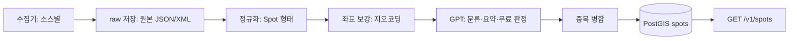

# Herezi 데이터 기획서

| 항목 | 내용 |
|---|---|
| 상태 | **승인됨** (2026-11-20, 위임 승인) |
| 버전 | v1.1 (2026-11-24 KOPIS 보류·§9.1 실측) |
| 날짜 | 2026-11-20 |
| 상위 문서 | [`SERVICE-PLAN.md`](SERVICE-PLAN.md) v1.0 (승인), [`PRODUCT.md`](PRODUCT.md), [`api/openapi.yaml`](../../api/openapi.yaml) `Spot` |
| 다음 단계 | M0 실측(§9, 이슈 #6) → M1 수집기 |

> 에이전트 규칙: 이 문서가 **승인됨** 상태가 되기 전에는 이 기획을 근거로 수집기 코드를 작성하지 않는다.
> 표기: **확인** = 2026-11-20 공식 페이지·명세·샘플 호출로 직접 확인. **미확인** = 공식 근거를 찾지 못했거나 2차 자료(블로그·GitHub 이슈)만 있음 → M0에서 실측.

---

## 1. 목표
1. 2027년 3월 16일 출시 시점에 **서울 25개 구 모두 "지금" 항목이 있는 상태**를 공공데이터만으로 만든다 (지표: 구당 평균 10개 이상, SERVICE-PLAN §10).
2. 9개 카테고리 중 **어느 것이 공공데이터로 채워지고, 어느 것이 비는지** 출시 전에 숫자로 안다.
3. 모든 `Spot`에 **좌표·기간·출처·갱신 시각**을 채운다. 하나라도 없으면 노출하지 않는다.
4. 라이선스상 **상업적 이용·출처 표기 조건**이 명확한 소스만 쓴다.

## 2. 결론 요약
| 판정 | 소스 |
|---|---|
| **사용 (M1 수집기)** | ① 서울시 문화행사 정보 ② TourAPI 행사정보 ④ 서울시 공공서비스예약(문화행사·교육) ⑤ 문화포털 한눈에보는문화정보 — 이슈 #42에서 구현 |
| **보류** (기관 서류 필요, 사업자 등록 후) | ③ KOPIS 공연 — 공연은 ① 서울 문화행사 + ⑤ 문화포털로 채운다 (2026-11-24 결정) |
| **사용 (수동 큐레이션)** | ⑥ 자연·계절: 명소 목록은 운영자가 만들고, 개화·단풍 시기는 기상청·산림청 발표를 수동 입력 |
| **보류** | 팝업 (공공 소스 없음 → 제휴 협의), 프로스포츠 일정 (라이선스 미확인), 서울 실시간 도시데이터 |
| **제외** | 인스타그램·팝업 앱·포털 크롤링, 푸드트럭 위치(공공 데이터 없음), 가로수 위치정보 |

---

## 3. 소스별 표

### 3.1 이벤트 소스
| # | 소스 | 카테고리 | 제공 필드 (핵심) | 좌표 | 갱신 주기 | 호출 제한 | 라이선스 / 출처 표기 | 키 발급 | 판정 |
|---|---|---|---|---|---|---|---|---|---|
| ① | [서울시 문화행사 정보](https://data.seoul.go.kr/dataList/OA-15486/S/1/datasetView.do) (`culturalEventInfo`, 원천: 서울문화포털) | performance, exhibition, festival, family + GPT 재분류 | `TITLE`, `CODENAME`(분류), `GUNAME`, `PLACE`, `STRTDATE`, `END_DATE`, `PRO_TIME`, `USE_FEE`, `IS_FREE`(유료/무료), `USE_TRGT`, `MAIN_IMG`, `HMPG_ADDR`, `ORG_LINK`, `RGSTDATE` | **있음** `LAT`=위도(37.x), `LOT`=경도(127.x) — 샘플 호출로 확인 | 매일 1회 (확인) | 1회 요청 최대 1,000건 ([이용안내](https://data.seoul.go.kr/together/guide/useGuide.do)). 일일 한도 **미확인** | **공공누리 1유형** (출처표시, 상업적 이용·변경 가능) — 확인 | 열린데이터광장 회원가입 → 일반 인증키 (샘플키는 5건까지) | **사용** (1순위) |
| ② | [TourAPI 국문 관광정보 서비스_GW](https://www.data.go.kr/data/15101578/openapi.do) `KorService2` — `searchFestival2`, `locationBasedList2`, `detailCommon2`, `detailIntro2` | festival (+ GPT로 food·pet·sports 재분류) | `contentid`, `title`, `addr1/2`, `eventstartdate`, `eventenddate`(YYYYMMDD), `firstimage`/`firstimage2`, `cpyrhtDivCd`, `lDongRegnCd`/`lDongSignguCd`, `progresstype`(취소·연기), `modifiedtime`, `tel` | **있음** `mapx`=경도, `mapy`=위도 (WGS84, swagger 확인) | 실시간 (확인) | 개발계정 **1,000/일**, 운영계정은 활용사례 등록 후 증설 신청 (확인) | 이용허락범위 "제한 없음". **이미지는 공공누리 1유형·3유형 혼재** → `cpyrhtDivCd`로 구분, 3유형은 변경 금지(크롭·필터 금지) + 출처 표시 (확인) | data.go.kr 활용신청: 개발 자동승인 / 운영 심의승인 (확인) | **사용** |
| ③ | [KOPIS 공연예술통합전산망](https://www.kopis.or.kr/por/cs/openapi/openApiInfo.do?menuId=MNU_00074) — `pblprfr`(목록·상세), `prfplc`(시설 상세), `prffest`(공연축제) | performance (아동공연 `kidstate=Y` → family) | 목록: `mt20id`, `prfnm`, `genrenm`, `prfstate`, `prfpdfrom`, `prfpdto`, `poster`, `fcltynm`, `openrun`. 상세: `mt10id`, `pcseguidance`(가격), `dtguidance`(시간), `child`, `festival`, `updatedate`, `relates`(예매처). 요청: `stdate`/`eddate`, `signgucode=11`(서울), `prfstate=02`(공연중) | **간접** — 공연엔 없음, `prfplc/{mt10id}`의 `la`(위도)/`lo`(경도)로 조인 ([가이드 v3.7](https://www.data.go.kr/data/15097844/openapi.do) 확인) | 실시간 (data.go.kr 표기) | **미확인** (공식 수치 없음, data.go.kr: "기관 정책에 따라 상이"). 2차 자료: 초당 10회 이상 시 서비스 중지, 목록 `rows` 최대 100·조회 기간 최대 31일 | data.go.kr 표기 "제한 없음". 출처 문구 "(재)예술경영지원센터 공연예술통합전산망(www.kopis.or.kr)" — **미확인**(2차 자료) | KOPIS 사이트에서 키 발급 (`service` 파라미터) — 기관 서류가 필요 | **보류** (기관 서류 필요, 사업자 등록 후). 공연 커버리지는 ①·⑤로 |
| ④ | 서울시 공공서비스예약 — [문화행사](https://data.seoul.go.kr/dataList/OA-2269/S/1/datasetView.do) `ListPublicReservationCulture`, [교육강좌](https://data.seoul.go.kr/dataList/OA-2268/S/1/datasetView.do) `ListPublicReservationEducation` (원천: yeyak.seoul.go.kr) | family, exhibition, performance, sports(일부) | `SVCNM`, `MAXCLASSNM`/`MINCLASSNM`, `SVCSTATNM`(접수중/종료), `PAYATNM`(무료/유료), `PLACENM`, `USETGTINFO`, `SVCOPNBGNDT`/`SVCOPNENDDT`(이용기간), `RCPTBGNDT`/`RCPTENDDT`(접수기간), `AREANM`, `IMGURL`, `SVCURL`, `DTLCONT` | **있음** `X`=경도, `Y`=위도 — 샘플 호출로 확인 | 비정기(수시) (확인) | ①과 동일 (1회 최대 1,000건) | 이용허락범위 "제한 없음", 저작권자 서울특별시 (확인) | ①과 같은 열린데이터광장 키 | **사용** (가족·체험 공백 보완) |
| ⑤ | [한국문화정보원 한눈에보는문화정보](https://www.data.go.kr/data/15138937/openapi.do) `B553457/cultureinfo` — `period2`, `area2`, `realm2`, `detail2` | exhibition, performance, festival, family(교육/체험) | `seq`, `title`, `startDate`, `endDate`, `place`, `realmName`, `area`, `sigungu`, `thumbnail`. 상세: `price`, `imgUrl`, `url`, `placeAddr`, `phone`, `contents1`. 요청: `serviceTp`(A 공연/전시, B 행사/축제, C 교육/체험), `from`/`to`, 좌표 범위(`gpsxfrom`~`gpsyto`) | **있음** `gpsX`=경도, `gpsY`=위도 (swagger 확인) | 실시간 (확인) | 개발계정 **10,000/일**, 운영 자동승인 (확인) | 이용허락범위 "제한 없음" (확인). 원천별 저작권 **미확인** | data.go.kr 활용신청 (확인) | **사용(보조)** — ①③과 중복 예상, M0에서 고유 항목 비율 실측 후 결정 |
| ⑥ | [서울 실시간 도시데이터](https://data.seoul.go.kr/dataList/OA-21285/S/1/datasetView.do) `citydata` `EVENT_STTS` | — | `EVENT_NM`, `EVENT_PERIOD`, `EVENT_PLACE`, `EVENT_X/Y`, `URL` | 있음 | 문화행사 1일 | 1회 1장소만 | — | ① 키 | **보류** — URL이 서울문화포털이라 ①과 같은 원천으로 보임 (샘플 확인). 신규 정보 없음 |

### 3.2 자연·계절 소스
| 소스 | 제공 내용 | API | 좌표 | 라이선스 | 판정 |
|---|---|---|---|---|---|
| 기상청 [날씨누리 계절관측 > 봄꽃개화현황](https://www.weather.go.kr) / 보도자료 | 서울 관측표준목(서울기상관측소 왕벚나무)·여의도 윤중로 **실제 개화일**. 2026년 서울 벚꽃 개화 3/29 (보도) | **미확인** — 기상자료개방포털 API 목록에서 계절관측 API를 찾지 못함 | 관측 지점만 | 미확인 | **사용(수동)** — 개화 발표일을 운영자가 입력 |
| 산림청·국립수목원 봄꽃·단풍 **예측지도** | 수종별 만개·절정 예상일 (2026-02-24 봄꽃 예측 발표, 단풍 절정 예측지도, 국립수목원 식물계절 검색서비스) | **없음(미확인)** — 보도자료·웹 서비스만 확인 | 지역 단위 | 미확인 | **사용(수동)** — 예상 시기만 참고 |
| 민간(웨더아이 등) 개화 예상 | 서울 개화·절정 예상일 | 없음 | — | 민간 저작물 | **제외** (참고만, 앱 노출 금지) |
| [서울시 주요 공원현황](https://data.seoul.go.kr/dataList/OA-394/S/1/datasetView.do) | 공원명·위치 | 열린데이터광장 | 있음(미확인 필드명) | 이용허락 "제한 없음"(확인) | **사용** — 명소 좌표 기반 |
| [서울시 관광 명소](https://data.seoul.go.kr/dataList/OA-21050/S/1/datasetView.do) | 명소 목록 (매월 갱신) | 열린데이터광장 | 미확인 | "제한 없음"(확인) | 보조 |
| [서울시 가로수 위치정보](https://data.seoul.go.kr/dataList/OA-1325/S/1/datasetView.do) | 벚나무 등 수종별 위치 | 파일 | 있음 | — | **제외** — 1회성 데이터(오래됨), 명소 단위가 아님 |
| TourAPI 행사정보 (봄꽃 축제) | 여의도 봄꽃축제 등 축제 기간·좌표 | ② | 있음 | ② | **사용** — 축제는 festival, 명소는 nature로 분리 |

**자연 카테고리 운영 방식 (제안)**
- 운영자가 **서울 벚꽃 명소 목록(약 20~40곳 목표, 미정)**을 직접 만든다: 명소명은 서울시 보도자료·공원 데이터에서, 좌표는 공원 데이터 또는 지오코딩으로.
- 각 명소 `Spot`의 `starts_at`/`ends_at` = 기상청 서울 개화 발표일 ~ 개화+약 2주(가정, 2026 실측으로 보정). 예측 단계에서는 산림청 예측 기반 "예상" 표시.
- 개화 상태(봉오리/개화/만개/낙화)는 API가 없으므로 M1에서는 **"예상 기간" 표시만** 하고, 상태 표시는 M3 회원 제보로 넘긴다 (SERVICE-PLAN §13).

### 3.3 팝업·펫·스포츠·먹거리
| 대상 | 공공 소스 | 평가 | 판정 |
|---|---|---|---|
| **팝업** | 없음. 공공데이터포털·열린데이터광장에서 팝업 영업 데이터를 찾지 못함 (성동구 등 자치구 데이터도 미발견) | 아래 3.4 참고 | **보류 → 제휴** |
| **펫** | TourAPI "반려동물 동반 여행 정보"는 **장소** 정보(행사 아님). 펫 행사는 ①②에 섞여 있을 가능성 | 별도 소스 없음. ①②에서 GPT 분류로 추출 | **GPT 재분류**, 항목 수 M0 실측 |
| **스포츠 (마라톤·생활체육)** | ①②④에 일부. ④ 체육시설 예약(OA-2266)은 시설 대관이라 행사 아님 | GPT 재분류 | **GPT 재분류** |
| **스포츠 (KBO·K리그 경기)** | 공식 일정 API 없음. KBO는 지식재산권 단속 사업자를 운영. 일정 데이터의 상업적 이용 조건은 **미확인** | 경기 일정이라는 사실 자체보다 DB·로고·명칭 사용이 문제 | **보류** — KBOP·한국프로축구연맹 문의 후 결정. M1 제외 |
| **푸드트럭** | 위치 데이터 없음. 휴게음식점 인허가 데이터는 이동 위치가 아니고 TM 좌표 | 실시간 위치는 불가 | **제외**. 야시장·먹거리 장터는 ①②에서 food로 재분류 |

### 3.4 팝업 확보 방안 평가
| 방안 | 법적 리스크 | 품질 | 비용 | 평가 |
|---|---|---|---|---|
| A. 인스타그램 크롤링 | **높음** — Meta 약관이 자동 수집을 금지. 저작권(사진·글), 정보통신망법 위반 소지 | 높음 | 중 | **제외** |
| B. 팝업 앱·포털(팝가 등) 크롤링 | **높음** — 데이터베이스제작자 권리(저작권법), 부정경쟁방지법 데이터 부정사용 조항, 약관 위반 소지 | 높음 | 중 | **제외** |
| C. 뉴스 기사 → GPT 추출 | 중 — 기사 본문은 저작물. 기간·장소 같은 **사실**만 뽑고 원문을 저장·노출하지 않으면 위험이 낮을 수 있으나 **법률 자문 필요** | 낮음 (기사 시점·정정 반영 늦음) | 중 | 보류 |
| D. 브랜드·운영사 공식 보도자료 → GPT 추출 → 운영자 검수 | 낮음~중 — 보도자료는 배포 목적. 사실 정보만 + 출처 링크 | 중 | 운영 인력 필요 | **M1 후보 (소량)** |
| E. 제휴 (팝업 앱, 공간 운영사, 성수 등 상권 단체, 브랜드 직접 등록) | 낮음 — 계약으로 해결 | 높음 | 협상 필요 | **권장 (M2 목표)** |

**권장**: M1은 팝업 카테고리를 **숨기거나**, D 방식으로 운영자가 주 단위로 대표 팝업 소량만 검수 등록한다. 본격 확보는 E(제휴). 결정은 PO(theo-ooooo).

---

## 4. 카테고리별 커버리지 판단
| 카테고리 | 주 소스 | 예상 커버리지 | 공백 / 대응 |
|---|---|---|---|
| `nature` | 수동 큐레이션 + 기상청·산림청 발표 | 봄(벚꽃)·가을(단풍) 시즌만. **실시간 상태 없음** | 명소 목록 운영자 작성. 비시즌엔 비어 있음 → 노을·야경 명소는 상시 항목 여부 결정 필요 |
| `festival` | ② TourAPI, ① 서울문화행사 | 대형 축제는 양호 (미확인) | 동네 플리마켓·소규모 행사는 누락 가능 |
| `performance` | ① 서울문화행사, ⑤ 문화포털 (③ KOPIS 보류) | 중 — KOPIS 없이 서울문화포털 등록 공연 위주 (2026-11-24 실측 §9) | 대학로 상업 공연 일부 누락 가능. KOPIS는 사업자 등록 후 재검토 |
| `exhibition` | ①, ⑤ | 공공 미술관은 양호, **상업 갤러리는 미확인** | 갤러리 전시 누락 가능 |
| `popup` | 없음 | **0** | §3.4 |
| `food` | ①② GPT 재분류 (야시장·먹거리 장터) | 낮음 | 푸드트럭 제외 |
| `family` | ④ 공공서비스예약, ③ 아동공연, ① | 중 | 예약 마감 행사 처리 규칙 필요 (§7) |
| `pet` | ①② GPT 재분류 | **매우 낮음 (미확인)** | M0 실측 후 0에 가까우면 M1에서 카테고리 숨김 |
| `sports` | ①② GPT 재분류 (마라톤 등) | 낮음 | 프로스포츠 보류 |

> "구당 평균 10개 이상" 달성 여부는 **M0 실측 전에는 판단할 수 없다.** 다만 ①은 누적 19,791건(2026-11-20 샘플 호출의 `list_total_count`, 종료 행사 포함)이라 서울 내 데이터 밀도는 가장 높을 것으로 본다.

---

## 5. Spot 필드 매핑
| `Spot` 필드 | ① 서울문화행사 | ② TourAPI | ③ KOPIS | ④ 공공서비스예약 | ⑤ 문화정보 | 비고 |
|---|---|---|---|---|---|---|
| `id` | `seoul_culture:` + `HMPG_ADDR`의 `cultcode` | `tourapi:` + `contentid` | `kopis:` + `mt20id` | `seoul_rsv:` + `SVCID` | `cultureinfo:` + `seq` | 내부 ID는 `{source}:{원천ID}`. 중복 병합 시 대표 ID 하나 유지 |
| `title` | `TITLE` | `title` | `prfnm` | `SVCNM` | `title` | HTML 엔티티 디코딩 (`&#39;` 등 실제 발생 확인) |
| `summary` | GPT ← `PROGRAM`, `ETC_DESC`, `USE_TRGT` | GPT ← `detailCommon2` 개요 | GPT ← 상세 `sty` | GPT ← `DTLCONT` | GPT ← `contents1` | 원천 내용에 없는 사실 추가 금지 |
| `category` | `CODENAME` 규칙 매핑 → 애매하면 GPT | 기본 festival → GPT 재분류 | performance (`child=Y`면 family 겸용 여부 결정 필요) | `MAXCLASSNM`/`MINCLASSNM` 매핑 → GPT | `serviceTp`/`realmName` 매핑 | 규칙 우선, GPT는 보조 |
| `lat` | `LAT` | `mapy` | 시설 `la` | `Y` | `gpsY` | 서울 범위(위도 약 37.4~37.7) 밖이면 버림 |
| `lng` | `LOT` | `mapx` | 시설 `lo` | `X` | `gpsX` | 경도 약 126.7~127.2 |
| `address` | 없음 → 역지오코딩 | `addr1` + `addr2` | 시설 `adres` | 없음 → 역지오코딩 | `placeAddr`(상세) | |
| `place_name` | `PLACE` | 없음 → `addr2`/GPT | `fcltynm` | `PLACENM` | `place` | |
| `starts_at` | `STRTDATE` | `eventstartdate` | `prfpdfrom` | `SVCOPNBGNDT` | `startDate` | 모두 KST. 시간 없으면 00:00 |
| `ends_at` | `END_DATE` | `eventenddate` | `prfpdto` | `SVCOPNENDDT` | `endDate` | 날짜만 오면 23:59:59로 저장 |
| `is_free` | `IS_FREE` == "무료" | 없음 → `detailIntro2` 이용요금 텍스트 GPT 판정 | `pcseguidance` 텍스트 ("무료" 포함) | `PAYATNM` == "무료" | `price` 텍스트 | 판정 불가면 `null` (무료 필터에서 제외) |
| `image_url` | `MAIN_IMG` | `firstimage` (`cpyrhtDivCd` 함께 저장) | `poster` (http → https 변환 필요, 2차 자료) | `IMGURL` | `imgUrl`/`thumbnail` | Type3 이미지는 크롭·필터 금지 |
| `source` | `seoul_culture` | `tourapi` | `kopis` | `seoul_reservation` | `cultureinfo` | openapi enum 설명에 추가 필요 |
| `source_url` | `HMPG_ADDR` | 없음 → visitkorea 상세 URL 생성 규칙 **미확인** | 없음 → KOPIS 상세 URL 규칙 **미확인** / `relates` | `SVCURL` | `url` | |
| `distance_m` | — | — | — | — | — | 서버 계산 (PostGIS) |

**openapi 보완 제안** (TECH-PLAN에서 결정): `updated_at`(갱신 시각, 상세 화면 필수), `attribution`(출처 문구), `image_license`(Type1/Type3), `is_free` nullable 허용.

---

## 6. 수집 파이프라인 개요

### 6.1 수집 주기 (제안, M0 호출량 실측 후 확정)
| 소스 | 주기 | 방식 | 호출량 추정 |
|---|---|---|---|
| ① 서울문화행사 | 매일 1회 (원천 갱신 직후, 시각 미확인) | 전체 페이징(1,000건 단위) | 누적 약 19,791건 → 20회 내외/일 |
| ② TourAPI | 매일 1회 목록 + 변경분만 상세 | `searchFestival2`에 서울 `lDongRegnCd` + 오늘 기준 기간, `modifiedtime`으로 변경분 판단 | 상세 호출이 많아 **개발계정 1,000/일로 부족할 수 있음** → 운영계정 전환 필요 |
| ③ KOPIS | 매일 1회 | `signgucode=11`, `prfstate=02`(공연중) + `01`(예정, 2주 이내). 신규 `mt10id`만 시설 상세 조회, 시설 좌표는 캐시 | 초당 호출 제한 대비 요청 간 지연 |
| ④ 공공서비스예약 | 매일 2회 | 전체 페이징 | 문화 888건·교육 307건 (샘플 `list_total_count`) |
| ⑤ 문화정보 | 매일 1회 | `period2` + 서울 좌표 범위 | 미확인 |
| 자연 | 시즌 중 수동 | 운영자 입력 (어드민 또는 시드 파일) | — |

### 6.2 정규화
- 날짜 포맷 통일 (`YYYYMMDD`, `YYYY.MM.DD`, `YYYY-MM-DD HH:MM:SS.0` 혼재 확인) → KST `timestamptz`.
- 좌표: 문자열 → double, 서울 경계 폴리곤 안인지 검사. 위도·경도 뒤바뀜 자동 감지(위도 값이 120 이상이면 교환).
- 텍스트: HTML 태그·엔티티 제거, 공백 정리.
- 카테고리: 소스별 코드 매핑 표를 코드로 관리 (`CODENAME`, `MAXCLASSNM`, KOPIS 장르, `serviceTp`).

### 6.3 중복 제거 (소스 간)
같은 행사가 ①·③·⑤에 동시에 있을 가능성이 높다 (예: KOPIS 공연이 서울문화포털에도 등록).
1. **후보 찾기**: 좌표 거리 ≤ 200m **그리고** 기간이 겹침 (값은 M0에서 조정).
2. **판정**: 제목 정규화(공백·괄호·연도 제거) 후 유사도 ≥ 임계값 → 같은 행사. 애매한 구간만 GPT에 "같은 행사인가" 질의 (yes/no + 근거).
3. **병합 우선순위**: 좌표·기간·가격 = 원천 성격이 가장 가까운 소스 (공연 → KOPIS, 서울 행사 → ①, 축제 → TourAPI). 이미지는 라이선스 1유형 우선.
4. **출처**: 대표 출처 1개 + 나머지는 `alt_sources`로 보관 (화면엔 대표 출처만).
5. 같은 공연장 안의 여러 공연은 좌표가 같으므로 **좌표만으로 병합하지 않는다** (2차 자료: KOPIS 인접 시설 좌표 차이 0~10m 사례).

### 6.4 GPT 사용처 (OpenAI)
| 용도 | 입력 | 출력 | 규칙 |
|---|---|---|---|
| 요약 | 원천 설명 텍스트 | 2~3줄 `summary` | 원문에 없는 날짜·가격·장소 생성 금지. 출력에 날짜가 있으면 원천과 대조 |
| 카테고리 분류 | 제목·원천 분류·설명 | 9개 enum 중 1개 + 신뢰도 | 규칙 매핑이 안 될 때만. 신뢰도 낮으면 원천 기본 카테고리 유지 |
| 무료 판정 | 요금 텍스트 | true / false / null | 확신 없으면 null |
| 지오코딩 보조 | 장소명·주소 텍스트 | **검색용 정제 질의** (예: "OO구청 앞 광장" → "OO구청") | **GPT가 좌표를 직접 만들지 않는다.** 좌표는 반드시 지도 API 결과 |
| 중복 판정 보조 | 후보 2건 | 같음/다름 | 애매 구간만 |
| 팝업 추출 (보류) | 보도자료 | 제목·기간·장소 | 운영자 검수 후에만 노출 |

비용·호출량은 신규·변경 항목만 처리하도록 해시 캐시. 금액 추정은 M0 실측 건수로 계산 (현재 **미산정**).

### 6.5 지오코딩
- 대상: 좌표 없는 항목(①④에는 대부분 좌표 있음, 팝업·수동 입력 항목), 주소 없는 항목의 역지오코딩.
- 1순위 **네이버 클라우드 Maps Geocoding / Reverse Geocoding** (앱이 네이버지도를 쓰므로 좌표 체계 일치), 2순위 **카카오 로컬 API**(키워드 장소 검색이 강함).
- 확인할 것 (**미확인**): 두 API의 무료 한도·요금, **결과 좌표 DB 저장(캐싱) 허용 여부**, 네이버 지오코딩 결과를 네이버 지도 외 용도로 쓰는 제한.
- 결과가 서울 밖이거나 여러 후보면 노출 보류 → 운영자 확인 큐.

---

## 7. 데이터 품질 규칙
| # | 규칙 |
|---|---|
| Q1 | **끝난 행사 숨김**: `ends_at < now()`면 목록·지도 API에서 제외(상세는 `is_ended: true`로 반환). 날짜만 있는 종료일은 그날 23:59:59 KST까지 노출 |
| Q2 | **너무 먼 미래 숨김**: 기본 조회는 "지금~이번 주". 시작이 30일 넘게 남은 것은 기본 목록에서 제외 (값은 TECH-PLAN 확정) |
| Q3 | **상시·장기 항목**: 기간이 매우 긴 항목(오픈런 공연, 상설 전시)은 "상시" 표시. 기준 기간은 M0 분포 보고 결정 |
| Q4 | **취소·연기**: TourAPI `progresstype`(취소·행사연기), KOPIS `prfstate` 반영. 원천에서 사라진 항목은 다음 수집 때 숨김 (소프트 삭제) |
| Q5 | **예약형 행사**: ④는 접수 상태(`SVCSTATNM`)와 이용 기간이 다름. 이용 기간 기준으로 노출하고 "접수 마감" 배지 표시 |
| Q6 | **필수 필드**: `title`, `category`, `lat/lng`, `starts_at`, `source`, `source_url` 중 하나라도 없으면 노출 안 함 (openapi `required` + `source_url`) |
| Q7 | **갱신 시각**: 항목마다 `fetched_at`(마지막 수집), `source_modified_at`(원천 수정일, 있으면) 저장. 상세 화면에 "N시간 전 갱신" 표시 |
| Q8 | **출처 표시**: 상세 화면에 출처명 + 원문 링크. 설정 화면(S6)에 소스별 라이선스·출처 문구 전체 목록. 공공누리 1유형은 출처 표시 의무, TourAPI Type3 이미지는 변경 금지 |
| Q9 | **수집 실패 감시**: 소스별 수집 건수가 전일 대비 크게 줄면 알림 (기준치 TECH-PLAN). 실패 시 직전 데이터 유지하되 갱신 시각은 그대로 둬서 오래됨이 보이게 |
| Q10 | **GPT 출력 검증**: 카테고리는 enum 밖이면 버림, 요약에 원천에 없는 숫자가 있으면 재생성 또는 요약 없이 노출 |

---

## 8. 리스크
| 리스크 | 영향 | 대응 |
|---|---|---|
| 공공데이터만으로 구당 10개 미달 | 핵심 지표 실패 | M0 실측 → 부족하면 반경 기본값 확대, 상시 항목(공원·문화공간) 보강 |
| TourAPI 개발계정 1,000/일 부족 | 축제 상세 누락 | 출시 전 **운영계정 전환(심의승인)** 일정 확보, 상세는 변경분만 |
| KOPIS 호출 제한·약관 미확인 | 차단·위반 | M0에 KOPIS에 이용 조건 문의, 요청 간 지연 |
| 소스 간 중복 → 같은 행사 여러 번 노출 | 신뢰도 하락 | §6.3 병합, 병합률 모니터링 |
| 벚꽃 실시간 상태 데이터 없음 | 차별점 약화 | "예상 기간" 표시 + 기상청 개화 발표 당일 수동 반영 + M3 제보 |
| 2027년 벚꽃 조기 개화 (2026년은 평년보다 10일 빠른 3/29) | 3월 말 출시 시 이미 개화 | 출시 목표를 **3월 16일**로 당김(SERVICE-PLAN v1.1), 자연 데이터는 2월 말 베타까지 준비 |
| 팝업 0건 | 경쟁 앱 대비 빈약 | §3.4 권장안, 카테고리 숨김 옵션 |
| 이미지 라이선스 (TourAPI Type3, 원천 이미지 저작권) | 분쟁 | `cpyrhtDivCd` 저장, 변경 금지 준수, 원천별 이미지 정책 M0 확인 |
| GPT 환각 (잘못된 날짜·장소) | 오류 정보 | 날짜·좌표·가격은 GPT 출력 사용 금지, 원천 값만 |
| 서울문화포털 원천이 ①⑤⑥에 공통 | 사실상 단일 장애점 | 소스 다변화(②③④), 수집 실패 알림 |
| 지오코딩 약관 (캐싱 금지 가능성) | 저장 구조 변경 | M0에 약관 확인 |

---

## 9. 검증 할 일 (M0: 키 발급 후 실측)
| # | 항목 | 방법 | 통과 기준 (가설) |
|---|---|---|---|
| V1 | 키 발급: 열린데이터광장, data.go.kr(TourAPI·문화정보), KOPIS | 신청 | 모두 발급 |
| V2 | **소스별 서울 "지금 진행 중" 항목 수** (기준일 1일 + 주말 1일) | 수집 스크립트로 `starts_at ≤ now ≤ ends_at` 집계 | 기록 |
| V3 | **구별·카테고리별 "지금" 항목 수** (중복 병합 후) | 구 경계 폴리곤 집계 | 구당 평균 10개 이상 |
| V4 | 소스 간 중복률 (①↔③, ①↔⑤, ②↔①) | §6.3 규칙 적용 | ⑤의 고유 항목 비율로 유지 여부 결정 |
| V5 | 좌표 결측·오류율 (서울 밖, 0값, 위경도 뒤바뀜) | 소스별 집계 | 소스별 기록 |
| V6 | `is_free` 판정 가능 비율 | 소스별 | 기록 |
| V7 | 이미지 보유율·Type1/Type3 비율 (TourAPI) | `cpyrhtDivCd` 집계 | 기록 |
| V8 | 일일 호출량 실제치 vs 한도 (TourAPI 1,000, 문화정보 10,000, 서울 미확인, KOPIS 미확인) | 1주 수집 로그 | 한도의 50% 이내 |
| V9 | KOPIS 이용 조건·호출 제한·출처 문구 공식 확인 | KOPIS 문의 / 공식 페이지 | 문서화 |
| V10 | 서울 열린데이터광장 일일 호출 한도, 원천 갱신 시각 | 공식 문의·관찰 | 문서화 |
| V11 | 카테고리 원천 코드값 전체 목록 (`CODENAME`, `MAXCLASSNM`, KOPIS 장르, `realmName`) | 전량 수집 후 distinct | 매핑 표 완성 |
| V12 | pet·food·sports로 재분류 가능한 항목 수 | GPT 분류 시험 (샘플 200건 수동 채점) | 정확도 기록, pet이 0에 가까우면 숨김 결정 |
| V13 | 네이버·카카오 지오코딩 한도·요금·캐싱 약관 | 약관 확인 | 문서화 |
| V14 | 기상청 계절관측(개화) API 존재 여부 | 기상자료개방포털·기상청 API허브 확인 | 있으면 자동화 |
| V15 | TourAPI·KOPIS 원문 상세 URL 생성 규칙 | 실제 응답 확인 | `source_url` 100% |
| V16 | 2027 봄 대비 서울 벚꽃 명소 목록 초안 + 좌표 | 운영자 작성 | 2월 말 완료 |
| V17 | 팝업 제휴 후보 접촉 여부 (PO 결정) | — | 결정 기록 |

---

### 9.1 실측 결과 (2026-11-24, 이슈 #42 수집기 첫 실행)
`go run ./cmd/ingest -out data/snapshot.json -max-gpt 150` 한 번 실행한 결과. 기준 시각 2026-11-24 12:07 KST, 시작이 90일 넘게 남은 항목 제외.

| 소스 | 받은 건수 | 저장 | 제외 (사유) | 중복 병합 | 좌표 결측 → 보강 | 무료 판정 가능 |
|---|---|---|---|---|---|---|
| ① 서울 문화행사 `culturalEventInfo` | 19,789 (누적, 20회 호출) | **297** (진행 중 184) | 끝남 19,488 | 4 | 결측 0 (깨진 위도 `37.57~2` 1건은 앞 숫자로 복구) | 100% (`IS_FREE`) — 무료 211·유료 86 |
| ④ 공공서비스예약 문화행사+교육강좌 | 1,155 (865+290) | **893** (진행 중 733) | 끝남 35, 좌표 없음 33, 서울 밖 10, 볼거리 아님(청년정보·정보통신·교양/어학) 50 | 134 (같은 장소·제목의 회차별 예약) | 결측 33 → 지오코딩 0 (장소명만 있음, 제외) | 100% (`PAYATNM`) — 무료 555·유료 338 |
| ② TourAPI `searchFestival2` (서울, 시작일 400일 전부터) | 189 | **17** | 끝남 167, 90일 넘는 미래 1 | 4 | 결측 0 | 14/17 (`detailIntro2` 이용요금) |
| ⑤ 문화포털 `area2` (sido=서울, 오늘~180일) | 485 | **405** | 좌표 없음 37 | 43 | 결측 40 → 장소명 색인 3, 지오코딩 0 | 0% — `detail2`가 10건 후 **HTTP 429**(한도 미확인)로 상세 못 받음 |
| **합계** | | **1,612** (진행 중 1,114) | | 185 | 지오코딩 26회 호출, 성공 0 | |

- **카테고리(병합 후)**: family 488, performance 428, nature 290, exhibition 270, festival 72, sports 41, pet 19, food 4, popup 0. KOPIS 없이도 performance 428건(문화포털 316 + 서울 문화행사 87 등).
- **원천 분류 코드값(V11, 진행 중·예정 기준)**: `CODENAME` 전시/미술·교육/체험·클래식·콘서트·기타·연극·국악·뮤지컬/오페라·축제-문화/예술·영화·무용·축제-자연/경관·축제-관광/체육·독주/독창회·축제-기타. 예약 `MAXCLASSNM>MINCLASSNM` 문화체험>(교육체험·산림여가·서울형키즈카페·공원탐방·전시/관람·문화행사·농장체험), 교육강좌>(자연/과학·기타·청년정보·역사·스포츠·공예/취미·도시농업·미술제작·교양/어학·정보통신). 문화포털 `realmName` 교육/체험·국악·기타·무용/발레·뮤지컬/오페라·아동/가족·연극·음악/콘서트·전시·행사/축제. 매핑 표는 `internal/ingest/sources`.
- **문화포털 고유 비율(V4, 일부)**: 405건 중 43건만 다른 소스와 병합(제목+기간+100m) → 대부분 고유(대학로 상업 공연). **유지**.
- **지오코딩(V13 일부)**: 네이버 Geocoding은 주소만 찾고 장소명(POI)은 못 찾는다("국립국악원" 0건). 좌표 없는 항목은 대부분 장소명만 있어 실패 → 제외. 장소 검색 API(카카오 키워드 등)는 후속.
- **호출량(V8 일부)**: 서울 22회, TourAPI 35회(목록 1 + 상세 17×2), 문화포털 목록 1회 + 상세 10회(429), 네이버 26회. 문화포털 `detail2`는 같은 날 앞선 시험 호출(~500회) 뒤 429가 계속됨 → 상세 일일·시간 한도 **미확인**, 수집기는 상한(기본 600)·429 즉시 중단으로 대응.
- **GPT(OpenAI `gpt-5.4-nano`, reasoning none)**: 150회(10건 배치) → 1,495건 요약, 입력 362,526·출력 70,218 토큰, 추정 약 US$0.16(단가 가정 입력 $0.20/출력 $1.25 per 1M). 이후 실행은 원문 해시(content_hash)가 같으면 재호출하지 않는다.
- **이미지 보유율**: 4개 소스 모두 100% (TourAPI `cpyrhtDivCd`는 아직 저장 안 함 → V7 후속).
- **`source_url`**: ①④ 100%, TourAPI 8/17(`homepage`), 문화포털 0%(상세 미수신) → V15 후속.

## 10. 미확인 항목 모음
| 항목 | 현재 근거 |
|---|---|
| 서울 열린데이터광장 일반 키 **일일** 호출 한도 | 공식 안내에서 "1회 최대 1,000건"만 확인 |
| KOPIS 호출 제한, 이용약관, 출처 표기 문구 | **보류**(키 발급에 기관 서류 필요, 사업자 등록 후 재검토) |
| 문화포털 `detail2` 호출 한도 | 2026-11-24 약 500회 뒤 HTTP 429 지속 (일일·시간 한도 미확인) |
| KOPIS 포스터 http→https 변환 필요 여부 | 2차 자료 |
| 문화정보(⑤)의 원천별 저작권, 서울 항목 수 | — |
| 기상청 계절관측·산림청 예측의 API 제공 여부 | API 미발견, 웹·보도자료만 확인 |
| 서울시 주요 공원현황 좌표 필드명 | 데이터셋 존재만 확인 |
| 펫·먹거리·스포츠 항목 수 | 실측 전 |
| 프로스포츠 일정 상업 이용 조건 | 확인 못함 |
| 네이버·카카오 지오코딩 한도·캐싱 약관 | 확인 안 함 |
| 팝업 뉴스·보도자료 GPT 추출의 적법성 | 법률 자문 필요 |
| 서울 벚꽃 개화 후 노출 기간 (+2주 가정) | 가정 |

---

## 승인
| 날짜 | 승인자 | 결과 | 메모 |
|---|---|---|---|
| | | | |

## 변경 이력
| 날짜 | 버전 | 내용 |
|---|---|---|
| 2026-11-20 | v0.1 | 초안 작성 |
| 2026-11-24 | v1.1 | KOPIS 보류(기관 서류 필요, 사업자 등록 후) — 공연은 서울 문화행사·문화포털로. §9.1 수집기 첫 실행 실측 추가 (이슈 #42) |

## 참고
- 서울시 문화행사 정보: https://data.seoul.go.kr/dataList/OA-15486/S/1/datasetView.do
- 서울 열린데이터광장 이용안내: https://data.seoul.go.kr/together/guide/useGuide.do
- 서울시 공공서비스예약(문화행사): https://data.seoul.go.kr/dataList/OA-2269/S/1/datasetView.do
- 서울시 공공서비스예약(교육강좌): https://data.seoul.go.kr/dataList/OA-2268/S/1/datasetView.do
- 서울 실시간 도시데이터: https://data.seoul.go.kr/dataList/OA-21285/S/1/datasetView.do
- 서울시 주요 공원현황: https://data.seoul.go.kr/dataList/OA-394/S/1/datasetView.do
- 서울시 관광 명소: https://data.seoul.go.kr/dataList/OA-21050/S/1/datasetView.do
- 서울시 문화공간 정보: https://data.seoul.go.kr/dataList/OA-15487/S/1/datasetView.do
- 서울시 가로수 위치정보: https://data.seoul.go.kr/dataList/OA-1325/S/1/datasetView.do
- 한국관광공사 국문 관광정보 서비스_GW (KorService2): https://www.data.go.kr/data/15101578/openapi.do
- KOPIS 오픈API 안내: https://www.kopis.or.kr/por/cs/openapi/openApiInfo.do?menuId=MNU_00074
- KOPIS 공연시설상세 (data.go.kr, 가이드 v3.7 PDF 첨부): https://www.data.go.kr/data/15097844/openapi.do
- 한국문화정보원 한눈에보는문화정보: https://www.data.go.kr/data/15138937/openapi.do
- KOPIS API 실사용 메모 (2차 자료): https://github.com/softy20/260923_ideathon/issues/1
- TourAPI searchFestival2 실사용 메모 (2차 자료): https://github.com/Haengyeon/Backend/issues/73
- 2026 서울 벚꽃 개화 보도: https://www.kukinews.com/article/view/kuk202603290044
- 산림청 2026 봄꽃 예측: https://www.newsseoul.co.kr/news/view/1065610218274681
- 기상청 서울 벚꽃 관측 기준 보도자료(2025): https://www.weather.go.kr/kma/flexer/html/press/2025/04/04/ATC202504041406132_1b2121a2-f6d6-4e38-836a-b37c7b8f1a66.hwp.files/Sections1.html
