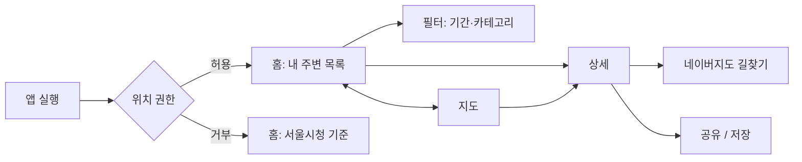

# Herezi 서비스 기획서

| 항목 | 내용 |
|---|---|
| 상태 | **승인됨** (2026-11-20) |
| 버전 | v1.1 (2026-11-20) |
| 범위 | 서울, 모바일 앱 (iOS · Android) |
| 다음 단계 | 데이터 기획(`DATA-PLAN.md`) · 기술 기획(`TECH-PLAN.md`) → 개발 (M0 진행 중) |

> 에이전트 규칙: 이 문서가 **승인됨** 상태가 되기 전에는 이 기획을 근거로 코드를 작성하지 않는다.
> 변경은 이 파일을 수정하고 하단 "변경 이력"에 남긴다.

---

## 1. 한 줄 정의
**앱을 열면, 위치만으로 "지금 내 주변에 뭐가 있는지" 보여주는 서비스.**
벚꽃 개화부터 축제, 공연, 전시, 팝업, 야시장까지 — 오늘·이번 주말에 실제로 갈 수 있는 모든 것.

## 2. 배경과 문제
- "이번 주말 어디 가지?"에 답하려면 네이버 검색, 인스타그램, 지자체 사이트, 팝업 앱을 **여러 곳 뒤져야** 한다.
- 기존 서비스는 **한 카테고리만** 다룬다 (팝업만, 공연만, 축제만).
- 회원 제보형 서비스는 **초기에 데이터가 없어서** 쓸모가 없다(콜드스타트).
- 사용자는 **등록·입력·가입을 귀찮아한다.** 처음 열었을 때 바로 가치가 보여야 남는다.

## 3. 타깃 사용자
| 페르소나 | 상황 | 원하는 것 |
|---|---|---|
| **주말 나들이족** (20~30대, 커플·친구) | 금요일 밤 "내일 뭐 하지?" | 이번 주말 갈 만한 곳 한눈에 |
| **동네 산책러** (전 연령) | 퇴근길·산책 중 | 지금 근처에 뭐 하는지 (야시장, 버스킹, 벚꽃) |
| **아이 있는 부모** (30~40대) | 주말 아이와 갈 곳 고민 | 무료·체험·가족 행사 필터 |
| **외부 방문자** | 약속·출장으로 낯선 동네 | 이 동네 지금 뭐 있는지 |

## 4. 핵심 사용 시나리오
1. **지금 근처**: 앱 실행 → 위치 허용 → 반경 3km 안에서 지금 진행 중인 것 목록·지도 → 상세 → 네이버지도 길찾기.
2. **주말 계획**: "이번 주말" 필터 + 카테고리(예: 축제·팝업) → 마음에 드는 것 저장.
3. **계절 체크**: 봄에 "벚꽃" 카테고리 → 개화 상태별 명소 지도.
4. **다른 동네 보기**: 지도를 움직여 다른 지역 탐색 (위치 허용 안 해도 서울 중심부터 보여줌).

## 5. 벤치마크 · 경쟁 분석
| 서비스 | 다루는 것 | 강점 | 한계 |
|---|---|---|---|
| 팝가 (스위트스팟) | 팝업스토어 | 랭킹, 웨이팅, 찜·알림, 위치 기반 | 팝업만 |
| 팝앤팝 / 프레젬 / 팝풀 | 팝업스토어 | 지도, 날짜 검색, 알림 | 팝업만 |
| 동행 | 동네 행사·축제·공연·개업 | 위치 기반, 키워드 알림 | 사용자 등록 의존, 데이터 밀도 |
| 대구어디가 | 대구 전시·공연·축제·팝업 | 달력+지도, **가입 불필요** | 대구 한정 |
| 서울축제지도 (서울시) | 서울 축제·공연 | 공식 데이터, 신뢰도 | 시즌별 지도 한 장, 앱 경험 아님 |
| 서울문화공연 등 공공데이터 앱 | 공연·전시·축제 | 공공데이터 기반 | 목록 위주, 위치·"지금" 경험 약함 |

**Herezi 차별점**
1. **모든 카테고리를 한 곳에** — 팝업·공연·축제·자연·계절을 한 지도에서.
2. **"지금" 중심** — 목록·지도에서 끝난 행사는 숨기고, 지금/오늘/주말만.
3. **자연·계절 정보** — 벚꽃·단풍 등 개화 상태는 경쟁 앱에 없다.
4. **입력 0** — 가입·등록 없이 첫 화면부터 꽉 차 있음 (공공데이터 + GPT 정리).

## 6. 서비스 원칙
1. **입력 0**: 위치 허용만으로 첫 화면이 채워진다. 가입은 알림을 원할 때만.
2. **공공 데이터 먼저, 제보는 덤**: 회원이 없어도 첫날부터 쓸모 있어야 한다.
3. **"지금" 우선**: 갈 수 없는 것(종료, 너무 먼 미래)은 목록·지도에 보여주지 않는다. 단, 이미 찜했거나 링크로 연 항목은 상세에서 '종료됨'으로 보여준다.
4. **정확성 > 양**: 틀린 정보(취소된 행사 등)는 신뢰를 무너뜨린다. 출처와 갱신 시각을 항상 표시.
5. **서울부터**: 서울에서 검증 후 확장.

## 7. 카테고리
| 코드 | 이름 | 예시 |
|---|---|---|
| `nature` | 자연·계절 | 벚꽃, 단풍, 핑크뮬리, 첫눈, 노을 명소 |
| `festival` | 축제·행사 | 지역축제, 불꽃놀이, 야시장, 플리마켓 |
| `performance` | 공연 | 콘서트, 뮤지컬, 무료공연, 버스킹 |
| `exhibition` | 전시 | 미술관·갤러리 전시 |
| `popup` | 팝업 | 팝업스토어, 브랜드 행사 |
| `food` | 먹거리 | 푸드트럭, 먹거리 장터 |
| `family` | 아이·가족 | 체험 프로그램, 키즈 행사 |
| `pet` | 반려동물 | 펫 페스티벌 |
| `sports` | 스포츠 | 경기, 마라톤 |

> 무료 여부는 카테고리가 아니라 **필터**로 다룬다 (§12 Q3).

## 8. MVP 기능 범위

### 포함 (M1)
| 우선순위 | 기능 | 설명 |
|---|---|---|
| P0 | 근처 목록 | 현재 위치 기준 거리순, 카드(제목·카테고리·거리·기간·무료 여부) |
| P0 | 지도 보기 | 네이버지도, 카테고리별 핀, 핀 묶음(클러스터) |
| P0 | 필터 | 카테고리(복수), 기간(지금/오늘/이번 주말/이번 주), 무료만 |
| P0 | 상세 | 사진, 요약, 기간·시간, 장소, 출처 링크, 갱신 시각 |
| P0 | 길찾기 | 네이버지도 앱으로 연결 |
| P0 | 위치 미허용 대응 | 서울 중심(시청) 기준으로 보여주고 지도 이동으로 탐색 |
| P1 | 공유 | 카카오톡·링크 공유 |
| P1 | 저장(찜) | 기기에 로컬 저장, 가입 없음 |
| P1 | 검색 | 키워드 검색 |

### 제외 (이후)
| 기능 | 시점 |
|---|---|
| 관심 지역·카테고리 푸시 알림 | M2 |
| 회원가입 / 로그인 | M2 (알림·기기 간 동기화가 필요할 때) |
| 회원 제보 ("지금 여기 이래요" 사진), 확인 투표 | M3 |
| 웨이팅·혼잡도 | M3 이후 |
| 리뷰·댓글·소셜 | 미정 |
| 서울 외 지역, 웹 버전 | 미정 |

## 9. 화면 구성 (MVP)
| # | 화면 | 주요 요소 |
|---|---|---|
| S0 | 스플래시 / 위치 권한 안내 | 왜 위치가 필요한지 한 문장, 허용 / 나중에 |
| S1 | 홈 (근처) | 상단: 현재 위치명 · 기간 탭 / 카테고리 칩 / 목록 ↔ 지도 전환 |
| S2 | 지도 | 핀·클러스터, 하단 카드 시트, "이 지역에서 다시 찾기" |
| S3 | 상세 | 이미지, 제목, 카테고리, 기간, 장소, 요약, 출처·갱신 시각, 길찾기·공유·저장 |
| S4 | 저장 목록 | 찜한 항목 (종료된 것은 흐리게) |
| S5 | 검색 | 키워드 + 최근 검색 |
| S6 | 설정 | 위치 권한, 정보 출처·이용약관, 오류 제보 |

### 사용자 흐름

## 10. 성공 지표 (MVP 출시 후 4주)
| 지표 | 목표 (가설) |
|---|---|
| 첫 실행 → 상세 1회 이상 조회 | 60% 이상 |
| 7일 재방문율 (D7) | 20% 이상 |
| 주말(금~일) 활성 비중 | 50% 이상 |
| 정보 오류 제보율 | 조회 1,000건당 1건 이하 |
| 서울 25개 구 각각 "지금" 항목 수 | 구당 평균 10개 이상 |

## 11. 수익 모델 (MVP에는 없음, 방향만)
1. **제휴 노출**: 팝업·행사 주최 측의 상단 노출(광고 표시 필수).
2. **예약·티켓 연결 수수료**: 공연·체험 예약 링크 제휴.
3. **B2B 데이터**: 지역 행사 데이터 API.

## 12. 결정 사항 (2026-11-20 승인)
| # | 질문 | 결정 |
|---|---|---|
| Q1 | 출시 플랫폼 | iOS · Android **동시** 출시 |
| Q2 | 출시 목표 시점 | **2027년 3월 16일** — 벚꽃 시즌 전 (2026년 서울 개화 3/29, 평년보다 10일 빠름). *v1.1에서 3월 말 → 3월 16일로 변경* |
| Q3 | `free`(무료)를 카테고리로 둘지, 필터로 둘지 | **필터** (무료 공연도 공연이므로) |
| Q4 | 위치 거부 시 기본 위치 | 서울시청 |
| Q5 | 데이터 소스 범위 | 공공데이터만으로 시작, 팝업은 데이터 기획에서 확보 가능성 확인 후 결정 |

## 13. 리스크와 가정
| 리스크 | 대응 |
|---|---|
| 공공데이터만으로 "지금" 항목이 부족할 수 있음 | 데이터 기획에서 구별 항목 수 실측 후 판단 |
| 팝업 정보는 공공데이터에 거의 없음 | 크롤링은 약관·저작권 검토 필수 → 제휴 또는 제외 |
| 개화 상태는 실시간 데이터가 없음 | 기상청·산림청 예상 시기 + M3 회원 제보로 보완 |
| 정보 오류(취소·변경) | 출처·갱신 시각 표시, 오류 제보 버튼 |
| 경쟁 앱(팝가 등)과의 비교 | 팝업 단일 경쟁이 아니라 "주변 전체"로 포지셔닝 |

---

## 승인
| 날짜 | 승인자 | 결과 | 메모 |
|---|---|---|---|
| 2026-11-20 | theo-ooooo | 승인 | §12 제안대로 결정 |

## 변경 이력
| 날짜 | 버전 | 내용 |
|---|---|---|
| 2026-11-20 | v0.1 | 초안 작성 |
| 2026-11-20 | v1.0 | 승인, §12 결정 확정, `free`를 필터로 변경 |
| 2026-11-20 | v1.1 | 출시 3/16로 당김, 끝난 행사는 상세에서 '종료됨'으로 노출 (사용자 결정) |

## 참고
- 팝가 출시 기사: https://byline.network/2025/02/13_2901827/
- 팝가 앱: https://apps.apple.com/kr/app/id6742811367
- 동행 앱: https://apps.apple.com/kr/app/id6743295780
- 대구어디가 앱: https://apps.apple.com/app/id6754386072
- 서울시 문화분야 누리집(서울축제지도): https://news.seoul.go.kr/culture/?p=533099
